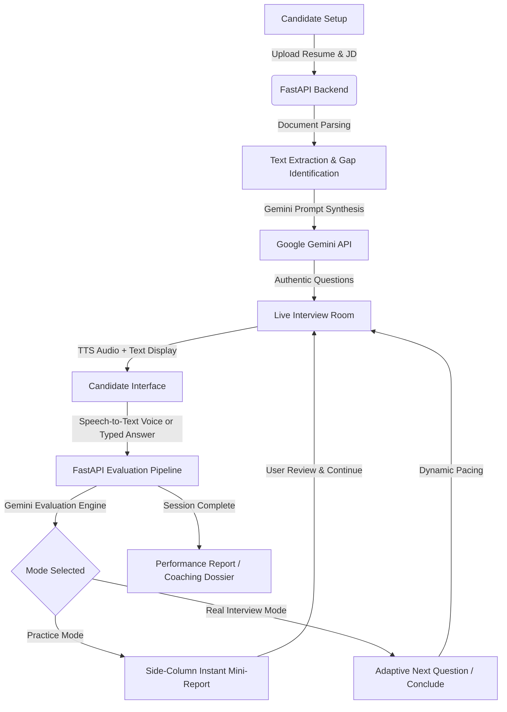

# IntervAI — Adaptive AI Interview & Career Coaching Platform

<p align="center">
  
</p>

<p align="center">
  <strong>Master your next interview with an adaptive, voice-enabled AI interviewer powered by Google Gemini.</strong>
</p>

<p align="center">
  
  
  
  
  
  
</p>

---

## 📌 Overview

**IntervAI** is an intelligent, voice-interactive mock interview platform designed to simulate authentic corporate hiring rounds. Unlike traditional interview tools that cycle through static question banks, IntervAI acts as an elite **Technical Hiring Manager & Lead Interviewer**. 

By parsing the candidate's **Resume** and target **Job Description (JD)**, IntervAI pinpoints skill gaps and formulates real-world, industry-standard interview problems. It dynamically regulates interview duration and probes deeper when candidates exhibit high technical depth.

---

## 🚀 Key Features

### 1. 🧠 Google Gemini Adaptive Question Engine
- Evaluates **Target Role**, **Seniority Level**, **Resume**, and **Job Description** concurrently.
- Formulates authentic questions tested in top tech companies across Technical, Behavioral (STAR), System Design, and Case Study tracks.
- **Adaptive Pacing:** Eliminates arbitrary question count limits. If an answer demonstrates intriguing depth, the AI dynamically generates follow-ups probing edge cases, failure scenarios, and architectural trade-offs.

### 2. 🎙️ Real-Time Voice Interaction (Speech-to-Text & Text-to-Speech)
- **Audio Question Delivery:** The AI interviewer naturally speaks questions using native speech synthesis.
- **Voice Transcription:** Candidates can speak their answers via the Web Speech API with real-time word-by-word streaming transcriptions.
- Includes typing mode, response timers, and automatic **Words-Per-Minute (WPM)** pacing analysis.

### 3. 📄 Automated Resume & Job Description Gap Scanner
- Extracts and parses **PDF** and **Word (.docx)** documents directly in-memory.
- Maps candidate proficiencies against requirements in the JD to surface critical topics the candidate may lack.

### 4. 🎓 Practice Mode with Dedicated Side-Column Mini-Reports
- In **Practice Mode**, submitting an answer does not abruptly skip to the next question.
- Instead, a dedicated **Side Column** illuminates with an instant **Question Mini-Report**:
  - 🎯 **Accuracy Score Meter** (0–100%)
  - 🧠 **Recommended Method & Framework** (e.g. STAR Framework, Top-Down System Decomposition, CAP Theorem analysis)
  - 🌟 **What You Should Answer** (ideal model points expected by senior interviewers)
  - 📊 **Performance Breakdown** (Key strengths with checkmarks, gaps & missing concepts)
  - ⚡ **Speaking Pace Assessment** (WPM)
- Advances **only** when the user clicks `"Continue to Next Question →"`.

### 5. 📊 Dual Reporting System
- **Practice Coaching Dossier:** Preserves a clean, chronological archive of all question mini-reports and frameworks for long-term revision from the user dashboard.
- **Real Interview Hiring Report:** Generates an executive scorecard featuring a **5-Dimension Skill Radar Chart** (Technical, Communication, Accuracy, Approach, Pace), overall hiring score, and personalized study recommendations.

### 6. 🛡️ Enterprise-Grade Security
- Passwords hashed with `bcrypt`.
- HTTP-only signed session cookies with configurable HTTPS enforcement.
- Strict security headers (`X-Content-Type-Options`, `X-Frame-Options`, `X-XSS-Protection`, `Permissions-Policy`).
- Rate limiting on authentication endpoints to prevent brute-force attacks.
- Disposable and temporary email domain rejection on signup.

---

## 🏗️ Architecture Workflow



---

## 💻 Tech Stack

| Domain | Technology |
|---|---|
| **Backend Framework** | [FastAPI](https://fastapi.tiangolo.com/) (Python 3.10+) |
| **ASGI Server** | [Uvicorn](https://www.uvicorn.org/) |
| **AI / LLM** | [Google GenAI SDK](https://github.com/google-gemini/generative-ai-python) (`gemini-3.5-flash-lite`) |
| **Database & ORM** | [PostgreSQL](https://www.postgresql.org/) with [SQLAlchemy](https://www.sqlalchemy.org/) |
| **Document Parsing** | `pypdf`, `python-docx` |
| **Authentication & Security** | `passlib[bcrypt]`, `itsdangerous`, Starlette Session Middleware |
| **Frontend UI** | Modern Vanilla JavaScript, CSS Grid, Chart.js, Web Speech API |

---

## 📁 Project Directory Structure

```text
IntervAI/
├── main.py                 # FastAPI application, database schemas, routes, and Gemini integration
├── requirements.txt        # Python package dependencies
├── run_intervai.ps1        # PowerShell automated execution script
├── static/
│   ├── style.css           # Glassmorphism dark-mode UI stylesheet
│   └── logo.svg            # Official IntervAI vector branding
├── templates/
│   ├── index.html          # Product landing page with feature highlights
│   ├── login.html          # Authentication page (login & register)
│   ├── dashboard.html      # Candidate dashboard, session metrics, and history
│   ├── interview-setup.html# Role, seniority, resume & JD upload setup
│   ├── interview.html      # Live interview arena with side-column coaching
│   └── report.html         # Performance report & Practice Coaching Dossier
└── .env                    # Environment configuration (ignored in version control)
```

---

## 🌐 Browser Audio Recommendation
For the best real-time voice experience (Speech-to-Text & Text-to-Speech), we recommend using **Google Chrome** or **Microsoft Edge**, as both provide full native support for the Web Speech Recognition and Web SpeechSynthesis APIs.

---

## 📄 License
This project is licensed under the [MIT License](LICENSE).